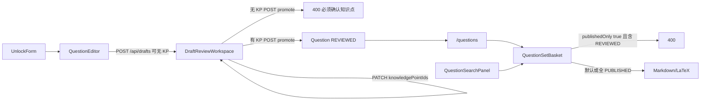

# Physhub 下一阶段：老师闭环（Phase D）

| 字段 | 值 |
| --- | --- |
| 日期 | 2026-09-07 |
| 状态 | Shipped（D1–D4 代码 + D2 Playwright 6 passed；Ubuntu 26.04 用系统 Chrome） |
| 前置 | [after-v1](docs/plans/2026-09-07-after-v1-next-plan.md) 的 A/B 已合 `master`（`2359c7b`） |
| 当前代码 | Phase D 工作区落地。harness 写草稿、人用名称勾选知识点后 promote。 |
| 单测 | `npm test`：49 files / 390 passed |
| E2E | `PLAYWRIGHT_CHROME_CHANNEL=chrome npx playwright test`：6 passed（Postgres `physhub-pg` + 系统 Chrome） |
| 审计 | 2026-09-07 进度审计：机器路径 ~95%，老师路径 ~60%，发布验收 ~40% |

---

## Overview

v1 的领域闭环已经在 `master` 上：外部 harness 只写 Draft / Suggestion，人 promote 才插入正式 `Question`，解锁页锁读。Phase B 给老师接了按钮，但人手主路径仍然断在元数据上——校对台和新草稿**不能用名字选择知识点**，Promote 会 400「必须确认知识点」。浏览器也没有 promote 验收。

本阶段只做一件事：**让老师不离开浏览器、不贴 cuid，就能把一道题从草稿变成可搜索的正式题，并用证据证明。** 组题篮和知识点树是同一周内的跟随项，不回头开 MCP / Meilisearch / 内嵌模型。

```text
解锁
 → New draft：选知识点（名字）+ 保存
 → 校对台：仍可改 KP / 题型 / 标签 / 难度
 → Promote（无 KP → 400；有 KP → Question）
 → /questions 可见、搜索可命中
 → Playwright 在 Postgres 上复现上述路径
```

---

## Background & Motivation

审计对照 after-v1 缺口表后的事实（以 `master` 为准）：

| 缺口 | 证据 | 本阶段 |
| --- | --- | --- |
| 人手草稿无法 promote | `question-editor.tsx` 不采集 KP；`drafts/[id]/page.tsx` 的 select **不含** `knowledgePointIds`；`buildEditorFields()` 不 PATCH 它们；`validatePublishableQuestion` 无 KP → 400 | **D1 关闭** |
| 正式题编辑器是逗号 cuid | `official-question-editor.tsx` 用 `knowledgePointIds.join(",")`；tags/difficulty 冻结 | **D1 关闭** |
| 编辑器只覆盖单选 | `AnswerEditor` 只有 `type: "single"`；New draft 写死 `SINGLE_CHOICE` | **D1 部分关闭**（选择题 + 文本题） |
| E2E 无 promote；Chromium 本环境未装 | `tests/e2e/` 只有 unlock + KaTeX；`test-results/` 报 browser missing | **D2 关闭** |
| 搜索不能加篮 | `QuestionSearchPanel` 无 `onAddToBasket`；结果也不是链接 | **D3 关闭** |
| 导出未强制 PUBLISHED | `createQuestionSetExport` 不看 status；B5 文档与代码分叉 | **D3 关闭** |
| Taxonomy 不是树 | UI 拍扁列表；`createKnowledgePoint` 已收 `parentId`，表单没用；`updateKnowledgePoint` 不改 parent | **D4 关闭** |
| 组题篮刷新即丢 | NQ-3 已接受内存态 | **维持** |
| MCP / Meilisearch / OCR worker | Phase C，等使用证据 | **不做** |

API 侧**已经**支持本阶段几乎全部写入，不必改 Prisma：

- `questionDraftFieldSchema` 已有 `knowledgePointIds` / `tagIds` / `difficulty` / `type`
- `GET /api/knowledge-points`、`GET /api/tags` 已鉴权
- `listKnowledgePoints()` / `listTags()` 已含 `parentId`、`sortOrder`、`group`
- seed 已有「物理 → 高一 → 运动学 → v-t 图像面积表示位移」和 4 个标签

缺的是把这些字段接到人能看懂的控件上，再用浏览器跑通。

---

## Goals & Non-Goals

### Goals

1. 老师用**名称**多选知识点、标签，选难度和题型；任何编辑页都不再出现逗号分隔的 cuid 输入框。
2. 人手路径：解锁 → New draft 选至少一个知识点 → 保存 → 校对台 Promote → `/questions` 看得到。Harness 路径保持原样。
3. 不完整草稿仍可保存（v1 约定）；**Promote** 仍服务端强制「必须确认知识点」。按钮在无 KP 时禁用，并显示原因；服务端 400 仍是权威。
4. 选择题（单选/多选）和文本答案题（填空/计算/证明/实验/图像分析）能在同一套编辑器里保存并 promote。
5. Playwright 在真实 Postgres 上覆盖：错误 secret、正确 secret、无 KP promote → 400、有 KP promote → 列表可见。文档写明 `npx playwright install chromium`。
6. 搜索结果可加篮；篮内显示 `publicId` + 题干摘要，不只是内部 id。
7. 导出增加教师显式开关「仅 PUBLISHED」；默认关（与 after-v1 B5 一致）；打开后若篮中有非 PUBLISHED → **400**，不静默丢题。
8. `/taxonomy` 按树缩进显示；创建可选父节点；可改 parent；成环 → 409。

### Non-Goals（本阶段明确不做）

- 改 `schema.prisma` / 新 migration（OQ-5 草稿 KP 继续 JSON 数组）。
- Next.js 内嵌 LLM / OCR、MCP、Meilisearch、Redis、PDF 导出、R2。
- NextAuth、多用户、登出按钮、可吊销单张 cookie（Phase C）。
- 组题篮持久化（NQ-3 维持内存）。
- 题图裁切、PDF 预览、学生/教师双预览、分页超过现有 50 条。
- Agent 新工具或削弱「agent 不能 promote」。
- 实验题/图像分析的专用画布或配图编辑（文本答案即可入库）。
- 把 `Asset` / `QuestionAsset` 表用起来。

---

## Proposed Design

### 分层与顺序

```text
D1 元数据选择器（关闭人手 promote 断点）
 → D2 浏览器闭环验收（依赖 D1 + 本机 Postgres）
 → D3 组题篮/搜索/导出 PUBLISHED（可与 D2 并行，不依赖 D1 UI）
 → D4 知识点树 UI（可与 D3 并行；选择器缩进可在 D1 先做浅树）
```

**禁止**在 D1 未合前开功能分叉。D2 是发布完成标准，不是可选项。



### D1 — 共享元数据控件，接到三条写路径

新建 `components/taxonomy/taxonomy-fields.tsx`（client）：

```ts
type TaxonomyFieldsProps = {
  knowledgePoints: KnowledgePointDto[]; // id, name, slug, parentId, sortOrder
  tags: TagDto[];
  knowledgePointIds: string[];
  tagIds: string[];
  difficulty: number | null;
  type: QuestionType | "";
  disabled?: boolean;
  onChange: (next: {
    knowledgePointIds: string[];
    tagIds: string[];
    difficulty: number | null;
    type: QuestionType | "";
  }) => void;
};
```

行为：

- 知识点：checkbox 列表，按树缩进（根 `parentId === null`，DFS；深度用 `padding-left`）。标签显示 `name`，不显示 id。无节点时提示去 `/taxonomy` 添加。
- 标签：按 `group` 分组的 checkbox。
- 难度：`<select>` 空 / 1–5。
- 题型：`<select>`，选项为 Prisma `QuestionType` 七值，label 用空格替换下划线（与列表页 `formatEnumLabel` 一致）。
- 无 cuid 文本框。

服务端在 **session 有效之后** 才 `listKnowledgePoints()` / `listTags()`，传给 client。无 cookie 仍只渲染 `UnlockForm`，零 Prisma（保持 A4）。

| 页面 | 改动 |
| --- | --- |
| `app/(dashboard)/questions/new/page.tsx` | session 后 list taxonomy，`<QuestionEditor knowledgePoints tags />` |
| `app/(dashboard)/drafts/[id]/page.tsx` | `draftSelect` 增加 `knowledgePointIds`、`tagIds`、`difficulty`；list taxonomy；传给 workspace |
| `app/(dashboard)/questions/[id]/page.tsx` | list taxonomy；把 `difficulty` 继续传入（已有） |

`QuestionEditor.handleSaveAsDraft` 的 JSON 增加 `type`、`knowledgePointIds`、`tagIds`、可选 `difficulty`。无 KP 仍 201（不完整草稿）。保存成功继续 `router.push(/drafts/:id)`。

`DraftReviewWorkspace`：

- state 初始化自 draft 的 JSON 数组（非数组则 `[]`）。
- `buildEditorFields()` **加入** `type`、`knowledgePointIds`、`tagIds`、`difficulty`。
- Promote 前仍先 `persistEditorFields()`。
- 无 KP 时 Promote `disabled`，旁边文案「Promote requires at least one knowledge point.」（中文错误仍来自服务端，保持现有「必须确认知识点」。）
- Accept suggestion 之后本地把 KP 写入 state（若 payload 含 id）；不依赖整页刷新才能 Promote。若当前 suggestion 卡片没有把 id 暴露到 DTO，至少在 accept 成功后 `router.refresh()` 或重新 GET——**选定：accept 成功后 `window.location.reload()` 太粗；改为 accept 响应不回 draft，client 若 payload 有 `knowledge_points[].id` 则 union 进 `knowledgePointIds`。** 现有 workspace 的 suggestion DTO 已有 `payload`。

`OfficialQuestionEditor`：删掉逗号 input；`difficulty` / `tagIds` 解冻，走同一控件。Save version 的 PATCH body 与现在相同形状（id 数组），只是来源改成 checkbox。

#### 题型与答案编辑器

扩展 `AnswerEditor`，不要新开一套表单：

| `QuestionType` | 选项区 | `answerJson` |
| --- | --- | --- |
| `SINGLE_CHOICE` | `OptionEditor` | `{ type: "single", value: label }`（现状） |
| `MULTIPLE_CHOICE` | `OptionEditor` | `{ type: "multiple", value: label[] }`，checkbox |
| 其余五类 | 隐藏 `OptionEditor` | `{ type: "text", value: string }`，textarea |

切换题型时的规则（写进组件，单测锁住）：

- 单选 ↔ 多选：保留 options；单选变多选时 `value: [previous]`（若非空）；多选变单选时取 `value[0]` 或第一个 option。
- 选择 → 文本：清空 options 不自动；隐藏即可，保存时不传 options（或传空导致校验失败——**选定：非选择题保存不包含 `options` 字段**，避免「选择题必须有选项」误伤）。
- 文本 → 选择：恢复默认四行空白选项（New draft 的 `initialOptions` 抽成常量），答案取第一项。

`questionInputSchema` / `validatePublishableQuestion` **不改语义**。非选择题本来就不要求 options。

New draft 默认仍是 `SINGLE_CHOICE` + 现有示例题干，但老师能改题型和知识点后再保存。

### D2 — 浏览器闭环

`playwright.config.ts` 已注入 `EDITOR_SESSION_SECRET`。补：

1. `docs/development.md`：E2E 需要 (a) `npx playwright install chromium`（b）可达的 `DATABASE_URL`（c）已 `db:migrate` + `db:seed`。`npm run test:e2e` 不自动 migrate，避免误伤开发库。
2. `package.json` 可加 `"test:e2e:install": "playwright install chromium"`，不是功能代码。
3. `tests/e2e/helpers/unlock.ts`：填 secret、点 Unlock，等到目标 heading。
4. `tests/e2e/promote.spec.ts`（需 DB；seed 知识点「运动学」slug `motion`）：

| 用例 | 期望 |
| --- | --- |
| 错误 secret | 保持 Unlock editor（现有 unlock.spec 保留） |
| 无 KP Promote | New draft 不勾选 KP → Save → Promote → 可见错误，文案含「必须确认知识点」；按钮若 disabled 则先断言 disabled，并单测已覆盖服务端 400。**E2E 选定：用 UI 能点到的路径。** 若按钮 disabled，E2E 改为：保存无 KP 的草稿后，用 `request.post('/api/drafts/:id/promote')` 带 cookie 断言 400——避免为了 E2E 把按钮做成可点的陷阱。UI disabled + API 400 双锁。 |
| 有 KP Promote | 勾选「运动学」→ Save → Promote → 出现 Promoted → 打开 `/questions`，题干可见 |
| 无 cookie `/drafts/[id]` | 只有 Unlock editor；页面 HTML 不含 `answerJson` / 答案文本 |

KaTeX smoke 保留。agent 403 继续由 `tests/unit/agent-cannot-publish.test.ts` 锁，不进 Playwright（省掉在浏览器里塞 Bearer）。

Promote 用唯一题干（例如 `E2E promote ${Date.now()} $a$`）避免和 seed/残留数据撞车。

失败时的信号：Chromium 缺失保持 Playwright 原错误（教 `playwright install`）；Postgres 不可达则 page 在解锁后 500——测试失败，不 skip 伪装绿。**不写 `test.skip(!DATABASE_URL)`**，以免 CI 静默空过。本机没库就不要跑 `test:e2e`。

### D3 — 组题篮与导出约束

`QuestionsWorkbench` 篮态从 `string[]` 改为：

```ts
type BasketItem = { id: string; publicId: string; stemMd: string };
```

- `QuestionList` 的 Add to basket 传入整项。
- `QuestionSearchPanel` 增加可选 `onAddToBasket`；结果卡片用 `result.id`（cuid）入篮，展示 `result.question_id`（publicId）。结果标题改成链到 `/questions/${result.id}`。
- `QuestionSetBasket` 列表显示 `publicId` + 题干前 80 字，Remove 仍按 `id`。
- POST `/api/question-sets` 的 `questionIds` 仍是内部 id。

导出：

```ts
// parseExportBody
{ format: "markdown" | "latex"; teacher: boolean; publishedOnly?: boolean }
```

默认 `publishedOnly: false`（现有单测零改语义）。`true` 时若任一 `item.question.status !== "PUBLISHED"` → throw 映射 **400** `Export requires PUBLISHED questions`。UI：checkbox「Published only」，默认未勾。Agent 导出 wrapper 走同一 `parseExportBody`，默认同样不强制——避免悄悄改变 harness。教师要对外讲义时再勾。

### D4 — 知识点树管理

API：

- `createKnowledgePoint` 已接受 `parentId`。创建表单加 Parent `<select>`（可选，空 = 根）。
- `updateKnowledgePoint` 增加可选 `parentId`（`null` 升为根）和 `sortOrder`。
- 成环：`newParentId === id` 或从 newParent 向上走到 id → `TaxonomyConflictError` → 409 `Knowledge point parent cycle`。
- 禁删仍被引用：已有 409，保持。
- UI：DFS 缩进列表；每行显示 name、slug、Delete；可选「改父节点」select + Save（PATCH）。不做拖拽。

标签仍是扁平 + group，不做成树。

选择器（D1）已按树缩进，D4 只补管理页和 PATCH parent。若 D1 先合，管理页未完成时老师仍可用 seed 树选「运动学」。

---

## API / Interface Changes

无新路由。行为增量：

| 接口 | 变化 |
| --- | --- |
| `POST /api/drafts`、`PATCH /api/drafts/:id` | 无。body 本就可带 KP；UI 开始发送。 |
| `POST /api/drafts/:id/promote` | 无。无 KP 仍 400；id 不存在仍 422。 |
| `PATCH /api/questions/:id` | 无。UI 改为发数组而非老师手拼字符串。 |
| `PATCH /api/knowledge-points/:id` | **有**：body 可含 `parentId`（string \| null）、`sortOrder`。成环 409。 |
| `POST /api/question-sets/:id/export` | **有**：可选 `publishedOnly`。默认 false。true 且含非 PUBLISHED → 400。 |
| Agent 全部 | 无新工具、无默认搜索再改。 |

页面 props 变化（破坏内部组件合同，有单测要改）：

- `QuestionEditor({ knowledgePoints, tags })`
- `DraftReviewWorkspace({ draft, knowledgePoints, tags })`，draft 增 `knowledgePointIds` / `tagIds` / `difficulty`
- `OfficialQuestionEditor({ question, knowledgePoints, tags })`

---

## Data Model Changes

**无。** 不改 `schema.prisma`，不新增 migration。草稿 KP 继续 JSON 数组（OQ-5）。`Asset` 表继续空转。

---

## Alternatives Considered

1. **New draft 保存就强制 KP**  
   否决。v1 明确不完整草稿可存；harness 也常先写题干再补 suggestion。强制保存会让「先打字再分类」失败。权威闸门留在 promote。

2. **校对台保留逗号 id，只在文档里教老师去 Taxonomy 复制**  
   否决。这正是当前断点。seed id 是 cuid，老师无法记忆。

3. **D1 只做 KP，题型/多选/文本答案留到以后**  
   部分合理（更小 PR），但物理题大量填空/计算，只做单选仍会逼老师用 harness 改 `type`。题型切换与 AnswerEditor 同文件，放进 D1 成本低。不做实验题画布。

4. **E2E 无 Postgres 时 skip**  
   否决。skip 会让 `test:e2e` 在干净机器上假绿。缺浏览器、缺库都应红，文档说明前置。

5. **导出默认只出 PUBLISHED**  
   否决。工作台默认可见 REVIEWED+PUBLISHED；组题练习常用未 publish 的入库题。与 B5「教师显式打开」一致，默认关。打开后 400 而不是过滤，避免老师以为导出了未纳入的题。

6. **组题篮改 session 持久化**  
   否决。NQ-3 已定 v1.1 内存。本阶段只让篮内能辨认题目。

---

## Security & Privacy

- 不新增公开路由。taxonomy GET 仍要 human session。
- Dashboard 锁读顺序不变：先 session，再 list KP / load draft。D1 实现时 `questions/new` 开始查库，**必须**把 list 放在 `if (!session) return <UnlockForm />` 之后。单测：无 cookie → prisma/list 零调用。
- 选择器只把 id 留在 checkbox `value`，界面显示 name。RSC 仍会把 id 序列化给已解锁编辑器——这是编辑所必需，与 A4「未解锁不序列化」不冲突。
- `publishedOnly` 不是保密边界（get_question 仍含答案，OQ-2 维持）。它只防止老师误把 REVIEWED 当对外讲义。
- Agent 仍不能 PATCH 正式题、不能 promote。

---

## Observability

不加新指标。Promote / export 400 文案保持稳定字符串，便于 E2E 和老师看懂。taxonomy 成环用固定 `Knowledge point parent cycle`。

---

## Rollout

- 无 feature flag。全是 UI 与导出可选字段，默认向后兼容。
- 回滚：还原 D1 组件即可，API 旧客户端（curl/harness）不受影响。
- `publishedOnly` 缺省等于今天的行为。
- 落地顺序：D1 必须先于 D2。D3/D4 可在 D2 之后或并行，但不阻塞「老师能 promote」的宣称。

---

## Testing Plan

| 层 | 用例 |
| --- | --- |
| 单测 TaxonomyFields | 勾选 name 不暴露「请输入 id」；缩进渲染子节点；onChange 发 id 数组 |
| 单测 QuestionEditor | Save body 含勾选的 `knowledgePointIds`；无勾选则省略或 `[]`（与 `omitAbsentDraftFields` 兼容——空数组应能 PATCH 清空，**选定：显式发送数组，包括空数组**，以便校对台取消全选。Create 空数组等于未确认。） |
| 单测 DraftReviewWorkspace | Promote 无 KP 时按钮 disabled；有 KP 时 POST promote；Save PATCH 含 KP/type |
| 单测 AnswerEditor | 单选/多选/文本切换规则 |
| 单测 pages | 无 cookie 不 list taxonomy、不查 draft；有 cookie 把 KP 传给编辑器（mock list） |
| 单测 official editor | PATCH body 为 id 数组而非逗号字符串 |
| 单测 export | 默认仍导出 REVIEWED；`publishedOnly: true` 遇 REVIEWED → 400 |
| 单测 taxonomy-write | parent 成环 409；合法改父成功 |
| 现有 promote-draft / agent 403 / 解锁页 | 回归必须绿 |
| E2E | 见 D2 表 |

`npm run check`（lint + typecheck + unit）是每个 PR 的门。`npm run test:e2e` 是 D2 的门，不塞进 `check`（构建生产 server 较慢，与 development.md 现状一致）。

---

## Risks

| 风险 | 严重度 | 缓解 |
| --- | --- | --- |
| 空数组 PATCH 把 harness 已写的 KP 清掉 | High | 校对台初始化必须读到 draft.knowledgePointIds；单测「已有 KP 的 draft 打开后 Promote 可点」 |
| Next 16 page 在 layout 前执行 | High | 沿用 A4：page 内第一件事 session；list 在其后 |
| E2E 污染开发库 | Medium | 唯一题干；不删除数据；文档说明用本地 DB |
| 多选题答案与选项校验 | Medium | 复用 `validatePublishableQuestion`「答案必须匹配选项」 |
| D1 范围膨胀（画布/裁图） | Medium | Non-Goals 写死；文本答案即可 |
| 树 DFS 无环假设 | Low | D4 写入时拒成环；D1 渲染对环做 visited 集合，避免死循环 |

---

## Key Decisions

1. **本阶段主题是老师闭环，不是新架构。** 不改 schema，不内嵌模型，不开 Phase C。
2. **不完整草稿可存；Promote 才强制 KP。** UI 禁用 + 服务端 400，不以 UI 代替校验。
3. **共享 `TaxonomyFields`，三处编辑器共用，禁止第三种 cuid 输入。**
4. **题型进入 D1：** 单选/多选/文本答案。不做专用实验画布。
5. **E2E 不 skip。** 缺浏览器或缺 Postgres 就失败；文档写前置。agent 403 不进 Playwright。
6. **`publishedOnly` 默认 false，打开则 400 而非过滤。**
7. **篮仍内存。** 只改展示和搜索加篮。
8. **D2 是「可宣称老师能用」的完成线；** D3/D4 是同一阶段但可后合。

---

## Open Questions

无需要用户拍板才能写代码的开放问题。下列已在本文选定，确认计划即确认这些选择：

- 保存不强制 KP / Promote 强制
- 导出默认不限 PUBLISHED
- 多选 + 文本答案进 D1
- E2E 不 skip

若要缩小 D1：可把「多选/文本答案」挪到 D1b。默认不拆，避免人手只能入库单选题。

---

## PR Plan

落地时把本文写入 `docs/plans/2026-09-07-teacher-closed-loop.md`（可与 D1 同一提交）。

| PR | 标题 | 依赖 | 主要文件 | 完成标准 |
| --- | --- | --- | --- | --- |
| D1 | `feat: taxonomy fields so humans can promote without cuids` | `master` | `components/taxonomy/taxonomy-fields.tsx`（新）；`components/question/{question-editor,official-question-editor,answer-editor}.tsx`；`components/draft/draft-review-workspace.tsx`；`app/(dashboard)/questions/new/page.tsx`；`app/(dashboard)/drafts/[id]/page.tsx`；`app/(dashboard)/questions/[id]/page.tsx`；对应 unit tests | 勾选 seed 知识点后 Save+Promote 的 fetch body 含 id 数组；无 KP 时 Promote disabled；无 cookie 仍不查库；`npm run check` 绿 |
| D2 | `test: e2e unlock and promote with knowledge point` | D1 | `tests/e2e/promote.spec.ts`；`tests/e2e/helpers/unlock.ts`；`docs/development.md`；可选 `package.json` script | 本机 Postgres + Chromium 下：无 KP API 400；有 KP 后 `/questions` 看得到；development.md 写 install/migrate/seed |
| D3 | `feat: search basket items and optional published-only export` | `master`（不硬依赖 D1） | `components/question/questions-workbench.tsx`；`components/search/{question-search-panel,question-set-basket}.tsx`；`components/question/question-list.tsx`；`lib/domain/question-set-export.ts`；export 单测 | 搜索可加篮；篮显示 publicId；`publishedOnly: true` + REVIEWED → 400 |
| D4 | `feat: taxonomy tree parent editor` | `master` | `lib/domain/taxonomy-write.ts`；`components/taxonomy/taxonomy-admin.tsx`；`tests/unit/taxonomy-write.test.ts`；taxonomy page 测试 | 缩进树；改父；成环 409 |

建议合并策略：D1 → 立刻 D2（同一工作分支也可，但测试 PR 分开更清晰）。D3、D4 在 D1 审查期间可并行。

**Phase D 成功标准（相对 after-v1「Phase B 成功」收紧）：**

```text
从 master clone
 → 按 README 设 secret、migrate、seed、dev
 → 打开 /questions/new，解锁
 → 用名字勾选「运动学」，保存
 → Promote 成功，/questions 可见
 → 不勾选知识点时 Promote 不可用，API 仍 400
 → 未解锁打开草稿详情看不到答案
 → npm test 绿；npm run test:e2e 在已装 Chromium + 有库的机器上绿
```

D3/D4 成功：搜索加篮能导出；仅 PUBLISHED 开关会拒 REVIEWED；taxonomy 能看到父子并拒绝成环。

---

## References

- `docs/plans/2026-09-07-after-v1-next-plan.md`（A/B 已合，C 仍冻结）
- 2026-09-07 进度审计（人手路径断在 KP UI；E2E 无 promote）
- `lib/domain/draft-schema.ts`（字段已存在）
- `lib/domain/question-schema.ts`（`必须确认知识点`）
- `lib/domain/taxonomy-repository.ts`（list 已含 parentId）
- `prisma/seed.ts`（`motion` / `vt-area-displacement`）
- `skills/physhub/SKILL.md`（agent 路径不改）
